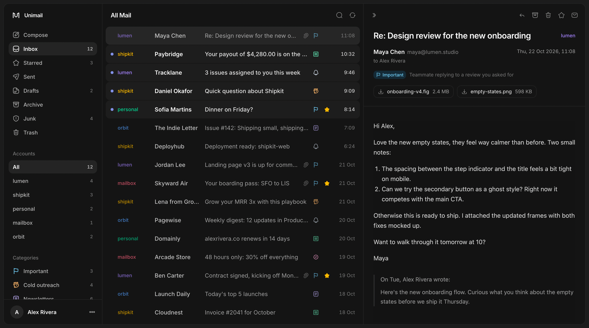

# Unimail

One web inbox for all your email accounts: Gmail, iCloud, Yahoo, Fastmail, Zoho, Titan, custom domains or any other IMAP/SMTP provider.



Unimail is self-hosted and single-user. You run your own copy, it keeps a local copy of your mail in SQLite, and you sign in with one password that you choose.

- Unified inbox across accounts, plus per-account views, search, stars, archive, junk and trash
- Reply, compose and send from any account, edit drafts
- Live sync over IMAP IDLE, so new mail shows up within seconds
- Optional AI sorting into Important, Cold outreach, Newsletters, Promotions, Notifications, Billing and Spam
- Light and dark mode, keyboard shortcuts

## Requirements

- [Node.js](https://nodejs.org) 22.9 or newer
- [pnpm](https://pnpm.io/installation) (`corepack enable` sets it up)
- A machine that stays on if you want mail to keep syncing (a small VPS or a home server works)

## Self-hosting

### 1. Get the code and install

```bash
git clone https://github.com/syeddhasnainn/unimail.git
cd unimail
pnpm install
```

Install all dependencies (not `--prod`): the build tools are needed for step 3.

### 2. Configure

```bash
cp .env.example .env
```

Then edit `.env`:

| Variable             | Required | What it does                                                                                                                |
| -------------------- | -------- | --------------------------------------------------------------------------------------------------------------------------- |
| `UNIMAIL_PASSWORD`   | yes      | The password you sign in with. Use something long and random.                                                               |
| `UNIMAIL_SECRET`     | yes      | Signs login sessions and encrypts the mailbox passwords stored in the database. Generate it with `openssl rand -base64 32`. |
| `DATABASE_PATH`      | no       | Where the database lives. Defaults to `data/unimail.db`.                                                                    |
| `OPENROUTER_API_KEY` | no       | Turns on AI classification. Leave empty to skip it.                                                                         |
| `PORT` / `HOST`      | no       | Where the web server listens. Defaults to port 3000 on all interfaces.                                                      |

Back up `UNIMAIL_SECRET` somewhere safe. If it is lost or changed, the stored mailbox passwords can no longer be decrypted and every account has to be added again.

### 3. Build and start

```bash
pnpm build
pnpm start
```

`pnpm start` runs both parts of Unimail in one process group:

- the **web app** on port 3000
- the **sync worker**, which keeps one IMAP connection per account and writes new mail to the database

The database and its tables are created on first start, and migrations run automatically after updates.

### 4. Sign in and add accounts

Open the app, sign in with `UNIMAIL_PASSWORD`, then go to **Settings → Add account** and enter an email address and its password. Unimail detects the IMAP and SMTP servers from the address (built-in presets, Mozilla's ISPDB, the domain's autoconfig file, its MX and SRV records). You can always change the servers by hand.

Provider notes:

- **Gmail**: turn on 2-Step Verification, then create an [app password](https://myaccount.google.com/apppasswords) and use it instead of your normal password.
- **iCloud**: use an [app-specific password](https://account.apple.com/account/manage).
- **Yahoo, AOL, Fastmail**: use an app password from the account's security settings.
- **Zoho**: use an app-specific password if two-factor authentication is on.
- **Outlook / Microsoft 365**: Microsoft blocks password sign-in for most accounts, so these usually fail for now.
- **Titan, custom domains and other IMAP hosts**: your normal mailbox password works.

Gmail and Outlook save sent mail on their own, so Unimail does not add its own copy to their Sent folder. For other providers it does; the **Save sent mail to the Sent folder** switch in each account's settings controls this.

## Running on a server

### Use HTTPS

In production the login cookie is only sent over HTTPS, so signing in over plain `http://` on a server will not stick. Chrome and Firefox make an exception for `http://localhost`, so a build running on your own machine works there too.

Put a reverse proxy in front and keep port 3000 private. With [Caddy](https://caddyserver.com), which gets certificates automatically:

```
mail.example.com {
  reverse_proxy 127.0.0.1:3000
}
```

and set `HOST=127.0.0.1` in `.env` so the app only listens locally. nginx, Traefik or Cloudflare Tunnel work the same way.

### Keep it running

Use any process manager. With [PM2](https://pm2.keymetrics.io):

```bash
pm2 start pnpm --name unimail -- start
pm2 save
```

To restart the two parts independently, run them as separate processes from the project directory instead:

```bash
pm2 start pnpm --name unimail-web -- start:web
pm2 start pnpm --name unimail-sync -- sync
```

Both read the same `.env` and database, so always start them from the project directory.

### Updating

```bash
git pull
pnpm install
pnpm build
pm2 restart unimail   # or however you run it
```

### Backups

Everything lives in two places: the database (`data/` by default) and `.env`. To back up the database while Unimail is running:

```bash
sqlite3 data/unimail.db ".backup unimail-backup.db"
```

Your mail itself stays on your providers' servers. The database holds the synced copy, your account settings, and AI labels.

## AI classification

With `OPENROUTER_API_KEY` set, the sync worker labels new inbox mail using `anthropic/claude-haiku-5.5` through [OpenRouter](https://openrouter.ai). Routing is pinned to Anthropic with no fallbacks, so the request never goes to another provider. Labels are stored per Message-ID, so each email is classified once, even if it moves between folders. Relabelling an email in the reader teaches the classifier and relabels other email from the same sender.

Without a key the worker logs a warning at startup and everything else works as usual.

## Security

- Unimail is single-user. Anyone with `UNIMAIL_PASSWORD` can read and send mail from every connected account, so pick a strong password and only expose the app over HTTPS.
- Sessions last 30 days. Signing out ends the session in that browser. Changing `UNIMAIL_PASSWORD` does not sign out other browsers.
- Mailbox passwords are encrypted at rest with AES-256-GCM using a key derived from `UNIMAIL_SECRET`.
- Emails are shown in a sandboxed frame with scripts disabled.

## Keyboard shortcuts

`j`/`k` next/previous · `Esc` close · `c` compose · `/` search · `r` reply · `e` archive · `#` trash · `s` star · `u` mark unread · `⌘↵` send

## Development

```bash
pnpm dev          # web app on :3000 and sync worker, both reload on code changes
pnpm dev:web      # web app only
pnpm dev:sync     # sync worker only
pnpm typecheck
pnpm lint         # oxlint
pnpm format       # oxfmt
```

- **App**: TanStack Start + shadcn/ui, SQLite via Drizzle (`src/routes`, `src/server`). Open tabs poll `/api/version` every few seconds and refresh when something changed.
- **Sync worker**: Effect v4 (`src/sync`).
- **Database**: the schema lives in `src/server/db/schema.ts`. After changing it, run `pnpm db:generate` to create a migration. Migrations apply automatically on startup.

## License

[MIT](LICENSE)
